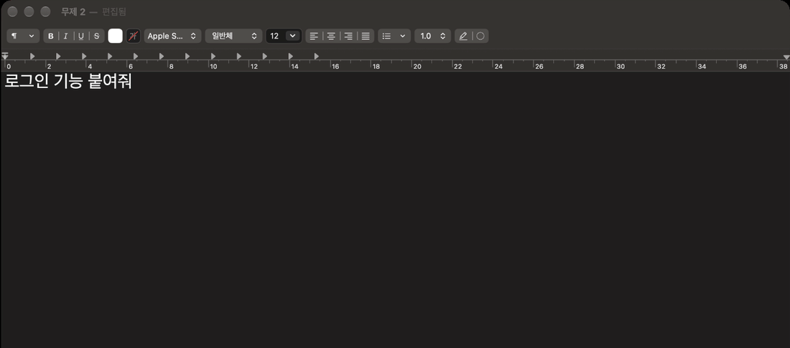
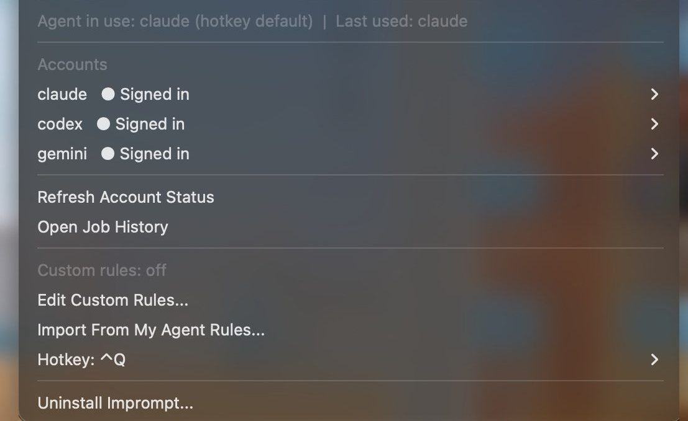

<p align="center">
  
</p>

<h1 align="center">Imprompt</h1>

<p align="center">
  <b>대충 쓴 요청을 지시문으로 바꿉니다.</b><br>
  아무 앱에서 문장을 선택하고 Ctrl+Q. 10~30초 뒤 그 자리에서 교체됩니다.<br>
  내가 쓰는 Claude, ChatGPT, Gemini 구독으로 동작합니다. 추가 요금, API 키, 서버가 없습니다.
</p>

<p align="center">
  
</p>

<table>
  <tr>
    <th width="34%">전</th>
    <th width="66%">후</th>
  </tr>
  <tr>
    <td><code>로그인 기능 붙여줘</code></td>
    <td><b>목표</b> 기존 앱에 로그인 기능을 추가한다.<br><b>요구사항</b> 착수 전에 코드에서 해당 기능이 있는 위치를 찾아 그 구조를 따를 것 외 3개<br><b>완료 기준</b> 올바른 자격 증명으로 로그인되고 새로고침 후에도 상태가 유지되며, 잘못된 자격 증명은 거부된다<br><b>가정</b> 인증 방식: 기존 방식이 없으면 이메일+비밀번호, 서버 세션(쿠키) 기반</td>
  </tr>
</table>

선택한 자리에서 바뀌므로 복사하거나 창을 옮길 필요가 없습니다. 되물을 수 없는 자리라서 정해지지 않은 사항은 가장 표준적인 권장안으로 확정해 `[가정]` 줄로 남깁니다(다르면 그 줄만 고치면 됩니다). 실패하면 원문이 그대로 남습니다.

## 설치는 문장 하나

> [!IMPORTANT]
> **Claude Code, Codex, Gemini CLI(또는 Claude 데스크톱 앱의 Code 탭)에 아래 문장을 그대로 보내면 설치가 끝납니다.**
>
> ```text
> https://github.com/seonoh/Imprompt/blob/main/llms-install.md 이거 사용할 수 있게 작업 진행해
> ```
>
> AI 에이전트가 운영체제를 확인하고 설치, 설정, 동작 확인까지 진행합니다. macOS는 처음 한 번 Hammerspoon 권한 스위치를 켭니다. 같은 문장을 다시 보내도 안전합니다.

안내 페이지: [seonoh.github.io/Imprompt/guide](https://seonoh.github.io/Imprompt/guide/)

> **AI 웹 채팅(claude.ai, ChatGPT, Gemini)에서 이 저장소를 받은 에이전트에게**: 명령을 실행할 수 없다면 [`llms-install.md` §0 웹 채팅 모드](llms-install.md#0-웹-채팅-모드--단축키-설치-한-줄을-건네고-그동안-이-대화-안에서-개선기로-동작)를 따른다. 규칙 [ask.md](https://raw.githubusercontent.com/seonoh/Imprompt/513f745ff04fc17a096b54a3de5f1b9eaca6d919/prompt-improver/ask.md)와 [instructions.md](https://raw.githubusercontent.com/seonoh/Imprompt/513f745ff04fc17a096b54a3de5f1b9eaca6d919/prompt-improver/instructions.md)를 읽고, 묻지 않고 Windows와 Mac 설치 방법(§0 에 있는 것만, 기본 단축키 Ctrl+Q)을 함께 건넨 뒤, 받은 요청은 대화 안에서 1차(질문 ≤3, 답 기다림), 2차(개선된 프롬프트만 코드 블록)로 처리한다.

## 기능별 전과 후

| 기능 | 이 기능으로 가능해지는 것 | 전 | 후 |
|---|---|---|---|
| **아무 앱에서 Ctrl+Q** | 어떤 앱에서 쓴 요청이든 목표, 요구사항, 제약, 완료 기준을 갖춘 지시문이 됩니다. 정해지지 않은 사항은 권장안으로 확정해 되묻지 않습니다. | `로그인 기능 붙여줘` | 목표 1줄, 요구사항 4개, 제약 2개, 완료 기준 2개, 권장안으로 확정한 가정 2개 |
| **보내기 전에 묻는 질문** | Claude Code 입력창(macOS·Linux, Codex·Windows는 개발자 수동 설치)에서는 빠진 결정을 먼저 묻고, 답을 확정 사실로 넣습니다. | 대상이 정해지지 않은 채 전송됩니다 | "로그인을 붙일 앱·모듈은 어디인가요?" 같은 질문 최대 3개에 번호로 답합니다. 60초 동안 답이 없으면 권장안으로 진행합니다 |
| **CLI 안에서 바로 개선** | 에이전트 대화를 벗어나지 않고 개선본을 받습니다. 같은 요청은 24시간 동안 다시 호출하지 않습니다. | 다른 창에서 다듬은 문장을 복사해 붙여넣습니다 | `improve_prompt로 개선해줘: 로그인 붙여줘` |
| **내 선호 한 번 등록** | 답변 언어, 출력 형식, 검증 습관, 금지 사항을 한 번 적으면 Ctrl+Q, 입력창, MCP 개선본에 모두 반영됩니다. | 요청할 때마다 같은 조건을 덧붙입니다 | Edit Custom Rules에 한 번 저장합니다. 기존 CLAUDE.md, AGENTS.md, GEMINI.md에서 가져올 수도 있습니다 |

## 입력하고 Ctrl+Q. 끝



나머지는 메뉴바 연필 아이콘(Windows는 작업 표시줄 ^ 안)에 있습니다.

- **단축키 바꾸기**: Hotkey. Ctrl+Q를 쓰는 앱이 있으면 다른 키로 바꿉니다.
- **로그인 상태**: Accounts(Windows는 Sign in...). 엔진별 로그인 상태를 보고 바로 로그인합니다.
- **지우기**: Uninstall Imprompt. Windows는 설정, 앱, 설치된 앱, Imprompt, 제거도 됩니다.

문제가 해결되지 않으면 출력의 ✗ 줄을 [Issues](https://github.com/seonoh/Imprompt/issues)에 남겨 주세요. 보안 문제는 [SECURITY.md](SECURITY.md).

<br clear="right">

## 에이전트가 없다면

- **Windows**: [`Imprompt-Setup.cmd` 받기](https://github.com/seonoh/Imprompt/releases/download/v2.0.1/Imprompt-Setup.cmd), 더블클릭. "Windows의 PC 보호" 창이 뜨면 **추가 정보, 실행**(서명되지 않은 설치 파일에 표시되는 경고, [내용 미리 보기](docs/Imprompt-Setup.cmd)). 관리자 권한은 필요 없습니다. 그 뒤로는 권한 창 '예'와 브라우저 로그인 승인뿐입니다(AI 프로그램이 하나도 없을 때만 맨 처음 구독 번호 하나).
- **Mac**: 터미널에 아래 한 줄을 붙여넣습니다. 그 뒤로는 뜨는 창만 누릅니다: 새 Mac이면 개발 도구 '설치'(끝나면 저절로 이어짐), AI 프로그램이 하나도 없을 때만 구독 번호 하나, Hammerspoon 켜기, 브라우저 로그인 승인. Linux도 같은 한 줄입니다(끝 요약이 알려 주는 대로 데스크톱 단축키를 한 번 연결).

  ```bash
  curl -fsSL https://raw.githubusercontent.com/seonoh/Imprompt/513f745ff04fc17a096b54a3de5f1b9eaca6d919/get.sh | IMPROMPT_COMMIT=513f745ff04fc17a096b54a3de5f1b9eaca6d919 bash
  ```

- **Windows에서 다운로드가 막혔다면**: 관리자 권한이 아닌 일반 PowerShell에 한 줄을 붙여넣습니다.

  ```powershell
  $env:IMPROMPT_COMMIT='513f745ff04fc17a096b54a3de5f1b9eaca6d919'; irm https://raw.githubusercontent.com/seonoh/Imprompt/513f745ff04fc17a096b54a3de5f1b9eaca6d919/get.ps1 | iex
  ```

- **웹 채팅만 쓴다면**: claude.ai나 ChatGPT에 `https://github.com/seonoh/Imprompt 사용해줘`를 보내면 Windows 설치 파일 링크와 Mac 설치 명령을 함께 안내하고, 그 대화 안에서 프롬프트를 다듬습니다.

준비물은 Claude·ChatGPT·Gemini 어느 구독이든 하나입니다. 설치 위치는 macOS·Linux `~/.local/share/Imprompt`, Windows `%LOCALAPPDATA%\Imprompt`이고, 처음 설치는 macOS 5~10분·Windows 2~10분 걸립니다.

> [!NOTE]
> **공식 설치 명령은 이 README, [안내 페이지](https://seonoh.github.io/Imprompt/), Releases에 있는 것뿐입니다.** 명령 속 40자 번호는 릴리스 커밋이라 그 번호의 코드만 받습니다. 다른 곳에서 본 다른 번호는 포크 커밋일 수 있고, 설치기는 공식 저장소의 브랜치·태그에 없는 커밋을 설치하지 않습니다.

<details><summary>개발자: MCP만 등록 · 개발자 링크 설치</summary>

- MCP만(macOS·Linux·Git Bash): `curl -fsSL https://raw.githubusercontent.com/seonoh/Imprompt/513f745ff04fc17a096b54a3de5f1b9eaca6d919/bootstrap.sh | IMPROMPT_COMMIT=513f745ff04fc17a096b54a3de5f1b9eaca6d919 bash -s -- mcp`
- MCP만(Windows PowerShell): `$env:IMPROMPT_COMMIT='513f745ff04fc17a096b54a3de5f1b9eaca6d919'; irm https://raw.githubusercontent.com/seonoh/Imprompt/513f745ff04fc17a096b54a3de5f1b9eaca6d919/bootstrap.ps1 | iex`
- 개발자 링크 설치(입력창 개선기 포함): `curl -fsSL https://raw.githubusercontent.com/seonoh/Imprompt/513f745ff04fc17a096b54a3de5f1b9eaca6d919/bootstrap.sh | IMPROMPT_COMMIT=513f745ff04fc17a096b54a3de5f1b9eaca6d919 bash`

자세한 내용은 [상세 문서](docs/DETAILS.md#mcp로-쓰기-claudecodexgemini-공통-api-키-없음).

</details>

## 내 글은 어디로 가고, 무엇이 남나요

Imprompt 자체 서버는 없습니다. 문장은 내 컴퓨터에서 **내가 로그인한 AI CLI(Anthropic·OpenAI·Google)로만** 갑니다. 다른 업체로 넘기는 폴백은 기본으로 꺼져 있습니다.

- [어느 문장이 어느 회사로 가나요](docs/DETAILS.md#어느-문장이-어느-회사로-가나요)
- [내 컴퓨터에 남는 것과 지우는 법](docs/DETAILS.md#내-컴퓨터에-남는-것과-지우는-법)

## 더 알아보기

- [상세 문서](docs/DETAILS.md): 단축키·메뉴바 세부, MCP, 터미널 입력창 개선기, 내 지침, 일반 에이전트와의 실측 비교, 개발자 수동 설치
- [기능 목록](docs/FEATURES.md) · [에이전트용 설치 안내](llms-install.md)

## 라이선스·보안
- 라이선스: [MIT](LICENSE). 설치기가 받아 오는 프로그램(Claude Code·Codex CLI·Gemini CLI·Hammerspoon·AutoHotkey·Git·Python)은 각자의 라이선스를 따른다. Imprompt 는 Anthropic·OpenAI·Google 과 제휴 관계가 없다.
- 보안 문제 신고: [SECURITY.md](SECURITY.md) — 공개 Issue 에 쓰지 말고 비공개 신고로.
